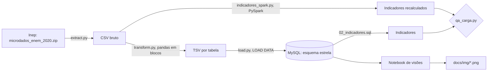
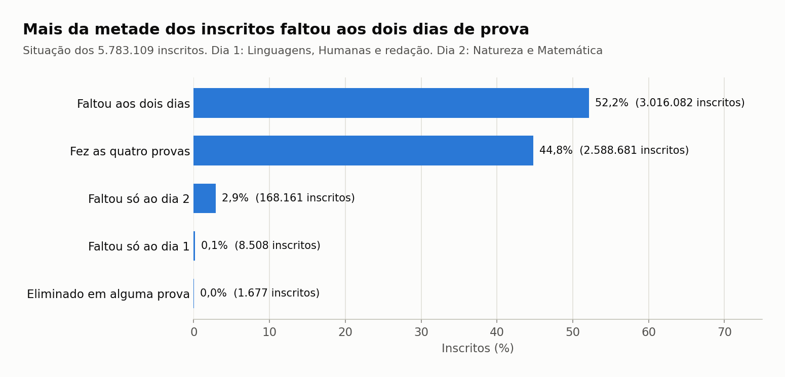
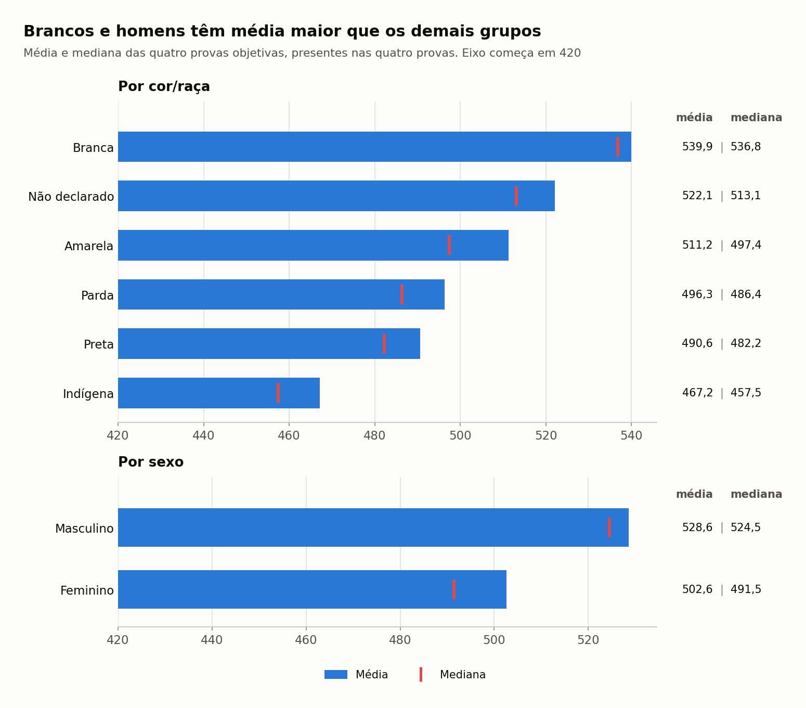
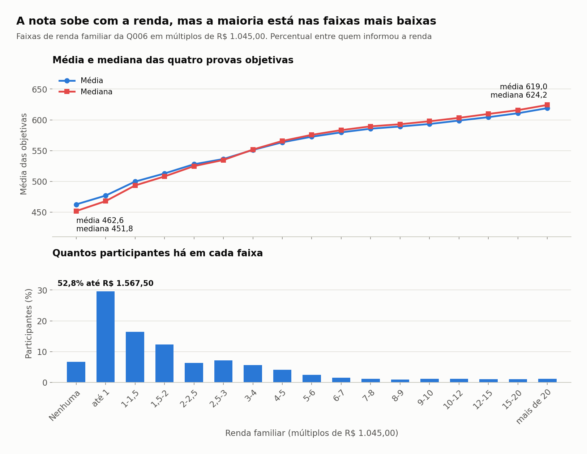

# ENEM 2020: modelagem, ETL e análise das notas

Entrega do teste técnico de Analista de Dados ([enunciado](docs/enunciado.md)). O pipeline baixa os microdados do ENEM 2020 publicados pelo Inep, modela a base em esquema estrela, carrega no MySQL com um ETL em Python, responde os oito indicadores em SQL, confere tudo com um recálculo independente em PySpark e gera as visões num notebook. Tudo roda em Docker.

| Pergunta | Resposta |
|---|---|
| 1. Escola com maior média | Não há escola individual no arquivo público: o Inep retirou o `CO_ESCOLA` a partir dos microdados da edição 2020. No nível mais fino disponível, o grupo com maior média é **escolas federais urbanas de Viçosa (MG)**, com **688,60** e 153 participantes |
| 2. Aluno com maior média | Inscrição **200001357436**, média **830,95** (CN 795,8, CH 839,5, LC 713,5, MT 975,0) |
| 3. Média geral | **512,89** (média das médias de quem fez as quatro provas objetivas) |
| 4. % de ausentes | **55,21%** faltaram a pelo menos um dos dois dias (52,30% no dia 1 e 55,06% no dia 2) |
| 5. Total de inscritos | **5.783.109** |
| 6. Média por disciplina | CN **490,41**, CH **511,15**, LC **523,80**, MT **520,58**, Redação **573,41** |
| 7. Média por sexo | Masculino **528,58**, Feminino **502,61** |
| 8. Média por cor/raça (etnia) | Branca **539,92**, Não declarado **522,08**, Amarela **511,22**, Parda **496,35**, Preta **490,58**, Indígena **467,16** |

As definições de cada métrica estão no [ADR-0006](docs/adr/0006-definicoes-das-metricas.md), e as tabelas completas em [`docs/indicadores.md`](docs/indicadores.md).

## Arquitetura



| Camada | Arquivo | O que faz |
|---|---|---|
| Extração | [`src/etl/extract.py`](src/etl/extract.py) | Baixa o zip do Inep com novas tentativas em caso de queda e extrai só os arquivos usados. Não refaz o que já existe |
| Transformação | [`src/etl/transform.py`](src/etl/transform.py) | Lê o CSV em blocos de 500 mil linhas, cria as chaves das dimensões, decodifica os códigos do dicionário e calcula a média das objetivas |
| Carga | [`src/etl/load.py`](src/etl/load.py) | Esvazia e carrega cada tabela com `LOAD DATA LOCAL INFILE` |
| Orquestração | [`src/etl/main.py`](src/etl/main.py) | Roda as três etapas e confere se o fato tem as mesmas linhas do CSV |
| Indicadores | [`sql/02_indicadores.sql`](sql/02_indicadores.sql) | As oito perguntas em SQL sobre o modelo |
| PySpark | [`src/spark/indicadores_spark.py`](src/spark/indicadores_spark.py) | Recalcula os indicadores direto do CSV bruto, sem passar pelo MySQL |
| QA | [`src/qa/qa_carga.py`](src/qa/qa_carga.py) | Confere grão, chaves, fan-out e faixas de valores, e compara SQL com PySpark |
| Visões | [`notebooks/analise_enem_2020.ipynb`](notebooks/analise_enem_2020.ipynb) | Gera os gráficos dos quatro blocos de visões |

## Como rodar

Pré-requisito: Docker com Compose. A forma mais simples é abrir o repositório num **GitHub Codespaces** (Code > Codespaces > Create), que já vem configurado pelo [`.devcontainer`](.devcontainer/devcontainer.json) com 4 núcleos e Docker.

1. Crie o `.env` a partir do exemplo e troque as duas senhas:

   ```bash
   cp .env.example .env
   ```

   No Codespaces, mude também `DATA_DIR_HOST=/tmp/enem-data`, porque o disco de `/tmp` é maior que o do projeto.

2. Construa a imagem da aplicação e suba o MySQL. O esquema é criado na primeira subida do banco:

   ```bash
   docker compose build app
   ```

   ```bash
   docker compose up -d --wait mysql
   ```

3. Rode o ETL (download, transformação e carga):

   ```bash
   docker compose run --rm app python -m src.etl.main
   ```

4. Recalcule os indicadores em PySpark e rode o QA, nessa ordem. O QA reaproveita o resultado do Spark gravado em `data/indicadores_spark.json`:

   ```bash
   docker compose run --rm app python -m src.spark.indicadores_spark
   ```

   ```bash
   docker compose run --rm app python -m src.qa.qa_carga
   ```

5. Gere a tabela de indicadores e execute o notebook, que regrava os gráficos em `docs/img/`:

   ```bash
   docker compose run --rm app python -m src.analise.indicadores_sql
   ```

   ```bash
   docker compose run --rm app jupyter nbconvert --to notebook --execute --inplace notebooks/analise_enem_2020.ipynb
   ```

Para abrir o Jupyter de forma interativa, use `docker compose run --rm --service-ports app jupyter lab --ip 0.0.0.0 --allow-root --no-browser` e acesse a porta 8888.

**Tempos medidos** num Codespace de 4 núcleos e 16 GB, a partir do zero, cerca de 28 minutos no total:

| Passo | Tempo |
|---|---:|
| Build da imagem | 2 min 31 s |
| Subida do MySQL | 48 s |
| ETL: download do Inep | 10 min |
| ETL: transformação | 2 min 21 s |
| ETL: carga | 5 min 17 s |
| PySpark | 1 min 42 s |
| QA | 2 min 4 s |
| Indicadores SQL | 56 s |
| Notebook | 2 min 10 s |

Rodando a sequência do zero, os gráficos, `docs/indicadores.md` e `docs/qa.md` saem idênticos aos versionados.

**Se o download do Inep falhar.** O servidor do Inep às vezes derruba conexões vindas de fora do Brasil, e o `extract.py` tenta três vezes. Se ainda assim falhar, baixe o [zip](https://download.inep.gov.br/microdados/microdados_enem_2020.zip) pelo navegador e coloque-o em `data/` (ou na pasta de `DATA_DIR_HOST`) com o nome `microdados_enem_2020.zip`. O ETL reconhece o arquivo pelo tamanho exato (620.776.982 bytes) e pula o download. O servidor também não envia o certificado intermediário da cadeia TLS. Por isso o repositório traz esse certificado público em [`docker/certs/`](docker/certs/), e a verificação HTTPS continua ligada.

## Modelo dimensional

Esquema estrela com grão de **uma linha por inscrição** ([ADR-0002](docs/adr/0002-esquema-estrela.md)). O diagrama, o dicionário das tabelas e as regras de transformação estão em [`docs/modelo_dimensional.md`](docs/modelo_dimensional.md).

| Tabela | Linhas | Conteúdo |
|---|---:|---|
| `fato_participacao` | 5.783.109 | Presença, notas das quatro provas, redação e competências, média das objetivas |
| `dim_questionario` | 5.783.109 | Q001 a Q025 do questionário socioeconômico, relação 1:1 com o fato |
| `dim_perfil` | 12.989 | Combinações de faixa etária, sexo, estado civil, cor/raça, nacionalidade, conclusão do ensino médio, tipo de escola, treineiro e língua |
| `dim_escola` | 10.323 | Município, UF, dependência, localização e situação da escola declarada, mais a linha "não informada" |
| `dim_local_prova` | 1.747 | Município e UF de aplicação |
| `dim_status_redacao` | 9 | Situação da redação |

## Qualidade dos dados

O [`qa_carga.py`](src/qa/qa_carga.py) roda 40 verificações por um caminho independente do ETL, e todas passam ([relatório](docs/qa.md)):

- **Grão**: o CSV bruto, o fato e o questionário têm as mesmas 5.783.109 linhas, sem inscrição repetida.
- **Integridade**: nenhuma chave do fato fica sem dimensão, e o join com todas as dimensões não multiplica linhas.
- **Valores**: notas entre 0 e 1000, competências entre 0 e 200, nota preenchida só para quem esteve presente e média só para quem fez as quatro provas.
- **SQL x PySpark**: os 23 indicadores comparados têm o mesmo valor nos dois caminhos.

## Visões

Médias e medianas por grupo usam todos os 2.588.681 participantes presentes nas quatro provas. O boxplot e os gráficos de correlação usam uma amostra fixa de 10% (cerca de 259 mil pessoas), que se repete igual a cada execução. A mesma regra de cores vale para todos os gráficos: a média é azul e a mediana é vermelha. Nas barras, a barra é a média e a marca vermelha sobre ela é a mediana, com os dois valores na coluna à direita. Nas linhas, a linha azul com bolinhas é a média e a linha vermelha com quadrados é a mediana. A linha cinza escura, quando aparece, é a referência de comparação. O título de cada gráfico já diz a conclusão. O código está no [notebook](notebooks/analise_enem_2020.ipynb).

### 1. A nota como indicador de desempenho



Mostra o que aconteceu com cada um dos 5.783.109 inscritos. 52,2% faltaram aos dois dias e 44,8% fizeram as quatro provas. Quase ninguém faltou a um dia só: quem faltou, em geral, faltou aos dois.


Cada barra conta quantos participantes tiveram a média naquela faixa de 10 pontos. A maioria fica entre 400 e 600. A mediana (linha vermelha, 503,9) divide os participantes em duas metades iguais. Ela fica abaixo da média (linha preta, 512,9) porque um grupo menor, com notas muito altas, puxa a média para cima.


Cada caixa mostra onde estão os 50% centrais das notas de uma prova, e a linha preta dentro dela é a mediana, com o valor escrito embaixo do nome da prova. Quanto mais alta a caixa, mais espalhadas são as notas: Matemática é a que mais varia. A redação tem a mediana mais alta (580,0).


A barra é a média dos participantes que fizeram a prova naquele estado, e a marca vermelha é a mediana. A linha cinza vertical é a média do Brasil (512,9). Só os sete estados do Sul e do Sudeste e o DF ficam acima dela. Em todos os estados a mediana fica abaixo da média.


Em cima, as escolas privadas e as federais ficam quase empatadas, bem à frente das municipais e estaduais. "Não informada" reúne quem não declarou escola. Embaixo, a média cai com a idade, de 521,9 aos 17 anos para 457,8 entre 66 e 70 anos.



Participantes brancos têm a maior média (539,9) e indígenas a menor (467,2). Homens têm média 26 pontos acima da das mulheres. A diferença aparece também na mediana (524,5 contra 491,5), então não é efeito de poucos casos extremos.

### 2. Correlações com a nota


Cada quadrado mostra o quanto uma variável do questionário sobe e desce junto com a nota de uma prova. A escala vai de -1 a 1, e 0 significa nenhuma relação. Azul indica que a nota sobe junto com a variável, e vermelho, que ela cai. Renda e número de computadores em casa têm as relações mais fortes. Tamanho da família e idade quase não se relacionam com a nota.


Mostra quanto das diferenças de nota entre os participantes cada variável explica sozinha. A renda familiar explica 25,3%, mais de três vezes a segunda colocada (cor/raça, 7,7%). Ser treineiro praticamente não muda a média.

### 3. Dados da redação


Em cima, quantas redações foram zeradas por cada motivo: deixar em branco e fugir do tema são os mais comuns. Embaixo, a média (barra) e a mediana (marca vermelha) nas provas objetivas de quem zerou por cada motivo. Todos ficam abaixo da média de quem não zerou (514,5, linha cinza).


Cada linha é uma prova objetiva. Da esquerda para a direita, a nota da redação aumenta, e as notas das quatro provas sobem junto. Matemática é a que mais sobe entre quem tirou as maiores notas na redação.


Mostra o quanto cada competência da redação sobe e desce junto com cada prova objetiva. Todas as relações são positivas e moderadas, de 0,37 a 0,52. A mais forte é entre a competência 1 (domínio da escrita formal) e a prova de Linguagens.

### 4. Questionário socioeconômico


Cada linha é uma prova. O eixo horizontal vai da família sem renda até a família com renda acima de 20 vezes R$ 1.045,00. As quatro notas sobem com a renda, e Matemática é a que mais sobe: 224 pontos entre as pontas.



Em cima, a média (azul) e a mediana (vermelha) em cada faixa de renda. Embaixo, quantos participantes estão em cada faixa. A média sobe de 462,6 para 619,0 entre as pontas, mas a maior parte dos participantes está embaixo: 52,8% dos que informaram a renda têm até R$ 1.567,50 por mês.


Em cima, a média sobe a cada nível de escolaridade da mãe, de 460,9 (nunca estudou) a 565,5 (pós-graduação). Embaixo, quem tem internet e computador em casa tem a maior média (541,9), e quem não tem nenhum dos dois, a menor (464,2). Ter computador sem internet aparece com média maior que ter internet sem computador.


Em cima, quem estudou em escola privada; embaixo, quem estudou em escola pública, com o mesmo eixo nos dois painéis para comparar a altura das linhas. A escola privada fica acima em todas as faixas, mas a distância diminui conforme a renda aumenta: 78,7 pontos na faixa sem renda e 36,6 na mais alta.

## Conclusões e insights

**Como ler esta seção.** Cada conclusão descreve algo que acontece junto nos dados, como "quem tem mais renda costuma ter nota maior". Isso não prova que uma coisa causa a outra. Renda, escola, região e escolaridade dos pais costumam andar juntas, e os dados não permitem separar o peso de cada uma. As notas do ENEM vão de 0 a 1.000.

**1. Mais da metade dos inscritos faltou a pelo menos um dia de prova.**  
De cada 100 inscritos, 55 não compareceram a pelo menos um dos dois dias. Só 2.588.681 pessoas, menos da metade dos 5,8 milhões de inscritos, fizeram as quatro provas objetivas. Como contexto, o Inep registra que a edição de 2020 foi adiada para janeiro de 2021 por causa da pandemia.  
*Gráfico: [Situação dos inscritos nos dois dias de prova](docs/img/13_situacao_inscritos.png).*

**2. Quanto maior a renda da família, maior a nota, e nenhum outro fator pesa tanto.**  
Entre todas as variáveis analisadas, a renda familiar é a que mais anda junto com o desempenho. Sozinha, ela responde por cerca de um quarto das diferenças de nota entre os participantes (25,3%, pela medida chamada eta²). É mais de três vezes o peso do segundo fator, cor/raça (7,7%).  
*Gráficos: [Quanto cada variável explica da variação da média](docs/img/06_eta_quadrado.png) e [Correlação de Spearman entre variáveis ordinais e as notas](docs/img/05_correlacao_spearman.png).*

**3. Quem tem a maior renda faz, em média, 156 pontos a mais que quem não tem renda.**  
Quem declara não ter renda familiar tem média de 462,6. Quem declara renda acima de R$ 20.900 por mês tem média de 619,0. E a maior parte dos participantes está na ponta de baixo: 52,8% dos que informaram a renda vivem em famílias com até R$ 1.567,50 por mês.  
*Gráficos: [Média e participantes por renda familiar](docs/img/15_media_por_renda.png) e [Notas por renda familiar](docs/img/10_notas_por_renda.png).*

**4. Em Matemática, a nota sobe 224 pontos da família sem renda até a de renda mais alta.**  
É a maior diferença entre as quatro provas: a nota vai de 454,4 para 678,4. Matemática também é a prova com as notas mais espalhadas, ou seja, há mais gente muito acima e muito abaixo da média do que nas outras (desvio-padrão de 117,2, contra 73,0 a 95,0 nas demais).  
*Gráficos: [Notas por renda familiar](docs/img/10_notas_por_renda.png) e [Notas por prova](docs/img/02_notas_por_prova.png).*

**5. Alunos de escolas federais têm média quase igual à dos de escolas privadas, e bem acima dos de escolas estaduais e municipais.**  
A média é 576,5 na rede privada, 569,3 na federal, 512,4 na municipal e 491,7 na estadual. Dos dez grupos de escolas com as maiores médias do país, nove são federais. Esse dado só existe para 15,6% dos inscritos, que são os que informaram a escola.  
*Gráfico: [Média por dependência da escola e por faixa etária](docs/img/04_media_dependencia_faixa.png). Os dez grupos estão na [tabela de indicadores](docs/indicadores.md), pergunta 1.*

**6. Entre os mais pobres, quem estudou em escola privada tem 79 pontos a mais que quem estudou em pública. Entre os mais ricos, a diferença cai para 37.**  
Aqui o tipo de escola é o que o próprio participante informou na inscrição. Na faixa sem renda, a diferença entre privada e pública é de 78,7 pontos. Na faixa acima de R$ 20.900, é de 36,6 pontos. Ou seja, o tipo de escola acompanha uma diferença maior justamente onde a renda é menor.  
*Gráfico: [Média por renda e tipo de escola](docs/img/12_renda_x_tipo_escola.png).*

**7. Quanto mais a mãe estudou, maior a nota, e quem tem internet e computador em casa faz 78 pontos a mais.**  
Filhos de mães que nunca estudaram têm média de 460,9. Quando a mãe tem pós-graduação, a média sobe para 565,5, mais de 100 pontos acima. Quem tem internet e computador em casa tem média de 541,9, contra 464,2 de quem não tem nenhum dos dois.  
*Gráfico: [Média por escolaridade da mãe e por internet e computador](docs/img/11_media_mae_internet.png).*

**8. Candidatos brancos e homens têm média maior que os demais grupos.**  
Participantes brancos têm a maior média entre os grupos de cor/raça: 539,92. Ela fica 49,3 pontos acima da média de pretos (490,58) e 72,8 acima da de indígenas (467,16). Os homens têm média de 528,58, 26 pontos acima da das mulheres (502,61), mesmo as mulheres sendo a maioria de quem fez as quatro provas (60,4%).  
*Gráfico: [Média por cor/raça e por sexo](docs/img/14_media_cor_raca_sexo.png).*

**9. Só os estados do Sul, do Sudeste e o Distrito Federal ficam acima da média nacional.**  
A média nacional é de 512,9. Os sete estados do Sul e do Sudeste e o DF ficam acima dela, e todos os demais ficam abaixo. Entre o estado com a maior média (São Paulo, 541,2) e o com a menor (Amapá, 476,8) há 64,4 pontos de diferença.  
*Gráfico: [Média por UF de aplicação](docs/img/03_media_por_uf.png).*

**10. Quem foi bem na redação também foi bem nas provas objetivas, e quem zerou a redação foi pior nelas.**  
A grande maioria das redações (97,1%) foi corrigida sem problemas. Quem teve a redação zerada, por deixar em branco ou fugir do tema, por exemplo, tem média de 422,1 a 470,9 nas provas objetivas, contra 514,5 de quem não zerou. Na outra ponta, a nota das objetivas sobe a cada faixa de nota da redação, nas quatro provas.  
*Gráficos: [Redações zeradas por motivo e média nas objetivas](docs/img/07_redacao_status.png), [Notas das objetivas por faixa de nota da redação](docs/img/08_objetivas_por_faixa_redacao.png) e [Competências da redação x provas objetivas](docs/img/09_competencias_x_provas.png).*

## Decisões e organização

As decisões de desenho estão registradas como ADRs em [`docs/adr/`](docs/adr/), com o resumo em [`docs/decisoes.md`](docs/decisoes.md). O trabalho foi organizado em [issues](https://github.com/RCHRDYv/Teste-Analista-de-Dados-SX/issues?q=is%3Aissue) no milestone "Entrega teste SX".

```
.devcontainer/      Configuração do GitHub Codespaces
docker/             Dockerfile da aplicação e certificado intermediário do Inep
sql/                DDL do esquema estrela e consultas dos indicadores
src/etl/            Extração, transformação, carga e domínios do dicionário
src/spark/          Recálculo dos indicadores em PySpark
src/qa/             QA da carga
src/analise/        Execução das consultas e geração de docs/indicadores.md
notebooks/          Notebook de visões
docs/               Modelo, ADRs, indicadores, QA, gráficos e enunciado
```

Fonte dos dados: INSTITUTO NACIONAL DE ESTUDOS E PESQUISAS EDUCACIONAIS ANÍSIO TEIXEIRA. Microdados do Enem 2020. Brasília: Inep, 2020. Disponível em: <https://www.gov.br/inep/pt-br/acesso-a-informacao/dados-abertos/microdados/enem>.
