# ENEM 2020: modelagem, ETL e análise das notas

Entrega do teste técnico de Analista de Dados ([enunciado](docs/enunciado.md)). O pipeline baixa os microdados do ENEM 2020 publicados pelo Inep, modela a base em esquema estrela, carrega no MySQL com um ETL em Python, responde os oito indicadores em SQL, confere tudo com um recálculo independente em PySpark e gera as visões num notebook. Tudo roda em Docker.

| Pergunta | Resposta |
|---|---|
| 1. Escola com maior média | Não há escola individual no arquivo público: o Inep retirou o `CO_ESCOLA` a partir dos microdados da edição 2020. No nível mais fino disponível, o grupo com maior média é **escolas federais urbanas de Viçosa (MG)**, com **688,60** e 153 participantes |
| 2. Aluno com maior média | Inscrição **200001357436**, média **830,95** (CN 795,8, CH 839,5, LC 713,5, MT 975,0) |
| 3. Média geral | **512,89** (média das médias de quem fez as quatro provas objetivas) |
| 4. % de ausentes | **55,21%** faltaram a pelo menos um dos dois dias (52,30% no dia 1 e 55,06% no dia 2) |
| 5. Total de inscritos | **5.783.109** |
| 6. Média por disciplina | CN **490,41**, CH **511,15**, LC **523,80**, MT **520,58**, Redação **573,41** |
| 7. Média por sexo | Masculino **528,58**, Feminino **502,61** |
| 8. Média por cor/raça (etnia) | Branca **539,92**, Não declarado **522,08**, Amarela **511,22**, Parda **496,35**, Preta **490,58**, Indígena **467,16** |

As definições de cada métrica estão no [ADR-0006](docs/adr/0006-definicoes-das-metricas.md), e as tabelas completas em [`docs/indicadores.md`](docs/indicadores.md).

## Arquitetura

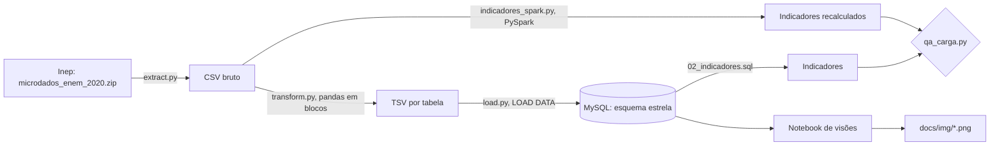

| Camada | Arquivo | O que faz |
|---|---|---|
| Extração | [`src/etl/extract.py`](src/etl/extract.py) | Baixa o zip do Inep com novas tentativas em caso de queda e extrai só os arquivos usados. Não refaz o que já existe |
| Transformação | [`src/etl/transform.py`](src/etl/transform.py) | Lê o CSV em blocos de 500 mil linhas, cria as chaves das dimensões, decodifica os códigos do dicionário e calcula a média das objetivas |
| Carga | [`src/etl/load.py`](src/etl/load.py) | Esvazia e carrega cada tabela com `LOAD DATA LOCAL INFILE` |
| Orquestração | [`src/etl/main.py`](src/etl/main.py) | Roda as três etapas e confere se o fato tem as mesmas linhas do CSV |
| Indicadores | [`sql/02_indicadores.sql`](sql/02_indicadores.sql) | As oito perguntas em SQL sobre o modelo |
| PySpark | [`src/spark/indicadores_spark.py`](src/spark/indicadores_spark.py) | Recalcula os indicadores direto do CSV bruto, sem passar pelo MySQL |
| QA | [`src/qa/qa_carga.py`](src/qa/qa_carga.py) | Confere grão, chaves, fan-out e faixas de valores, e compara SQL com PySpark |
| Visões | [`notebooks/analise_enem_2020.ipynb`](notebooks/analise_enem_2020.ipynb) | Gera os gráficos dos quatro blocos de visões |

## Como rodar

Pré-requisito: Docker com Compose. A forma mais simples é abrir o repositório num **GitHub Codespaces** (Code > Codespaces > Create), que já vem configurado pelo [`.devcontainer`](.devcontainer/devcontainer.json) com 4 núcleos e Docker.

1. Crie o `.env` a partir do exemplo e troque as duas senhas:

   ```bash
   cp .env.example .env
   ```

   No Codespaces, mude também `DATA_DIR_HOST=/tmp/enem-data`, porque o disco de `/tmp` é maior que o do projeto.

2. Construa a imagem da aplicação e suba o MySQL. O esquema é criado na primeira subida do banco:

   ```bash
   docker compose build app
   ```

   ```bash
   docker compose up -d --wait mysql
   ```

3. Rode o ETL (download, transformação e carga):

   ```bash
   docker compose run --rm app python -m src.etl.main
   ```

4. Recalcule os indicadores em PySpark e rode o QA, nessa ordem. O QA reaproveita o resultado do Spark gravado em `data/indicadores_spark.json`:

   ```bash
   docker compose run --rm app python -m src.spark.indicadores_spark
   ```

   ```bash
   docker compose run --rm app python -m src.qa.qa_carga
   ```

5. Gere a tabela de indicadores e execute o notebook, que regrava os gráficos em `docs/img/`:

   ```bash
   docker compose run --rm app python -m src.analise.indicadores_sql
   ```

   ```bash
   docker compose run --rm app jupyter nbconvert --to notebook --execute --inplace notebooks/analise_enem_2020.ipynb
   ```

Para abrir o Jupyter de forma interativa, use `docker compose run --rm --service-ports app jupyter lab --ip 0.0.0.0 --allow-root --no-browser` e acesse a porta 8888.

**Tempos medidos** num Codespace de 4 núcleos e 16 GB, a partir do zero, cerca de 28 minutos no total:

| Passo | Tempo |
|---|---:|
| Build da imagem | 2 min 31 s |
| Subida do MySQL | 48 s |
| ETL: download do Inep | 10 min |
| ETL: transformação | 2 min 21 s |
| ETL: carga | 5 min 17 s |
| PySpark | 1 min 42 s |
| QA | 2 min 4 s |
| Indicadores SQL | 56 s |
| Notebook | 2 min 10 s |

Rodando a sequência do zero, os gráficos, `docs/indicadores.md` e `docs/qa.md` saem idênticos aos versionados.

**Se o download do Inep falhar.** O servidor do Inep às vezes derruba conexões vindas de fora do Brasil, e o `extract.py` tenta três vezes. Se ainda assim falhar, baixe o [zip](https://download.inep.gov.br/microdados/microdados_enem_2020.zip) pelo navegador e coloque-o em `data/` (ou na pasta de `DATA_DIR_HOST`) com o nome `microdados_enem_2020.zip`. O ETL reconhece o arquivo pelo tamanho exato (620.776.982 bytes) e pula o download. O servidor também não envia o certificado intermediário da cadeia TLS. Por isso o repositório traz esse certificado público em [`docker/certs/`](docker/certs/), e a verificação HTTPS continua ligada.

## Modelo dimensional

Esquema estrela com grão de **uma linha por inscrição** ([ADR-0002](docs/adr/0002-esquema-estrela.md)). O diagrama, o dicionário das tabelas e as regras de transformação estão em [`docs/modelo_dimensional.md`](docs/modelo_dimensional.md).

| Tabela | Linhas | Conteúdo |
|---|---:|---|
| `fato_participacao` | 5.783.109 | Presença, notas das quatro provas, redação e competências, média das objetivas |
| `dim_questionario` | 5.783.109 | Q001 a Q025 do questionário socioeconômico, relação 1:1 com o fato |
| `dim_perfil` | 12.989 | Combinações de faixa etária, sexo, estado civil, cor/raça, nacionalidade, conclusão do ensino médio, tipo de escola, treineiro e língua |
| `dim_escola` | 10.323 | Município, UF, dependência, localização e situação da escola declarada, mais a linha "não informada" |
| `dim_local_prova` | 1.747 | Município e UF de aplicação |
| `dim_status_redacao` | 9 | Situação da redação |

## Qualidade dos dados

O [`qa_carga.py`](src/qa/qa_carga.py) roda 40 verificações por um caminho independente do ETL, e todas passam ([relatório](docs/qa.md)):

- **Grão**: o CSV bruto, o fato e o questionário têm as mesmas 5.783.109 linhas, sem inscrição repetida.
- **Integridade**: nenhuma chave do fato fica sem dimensão, e o join com todas as dimensões não multiplica linhas.
- **Valores**: notas entre 0 e 1000, competências entre 0 e 200, nota preenchida só para quem esteve presente e média só para quem fez as quatro provas.
- **SQL x PySpark**: os 23 indicadores comparados têm o mesmo valor nos dois caminhos.

## Visões

Os gráficos agregados usam todos os participantes presentes nas quatro provas. Distribuições e correlações usam uma amostra determinística de 10% (cerca de 259 mil pessoas). O código está no [notebook](notebooks/analise_enem_2020.ipynb).

### 1. A nota como indicador de desempenho

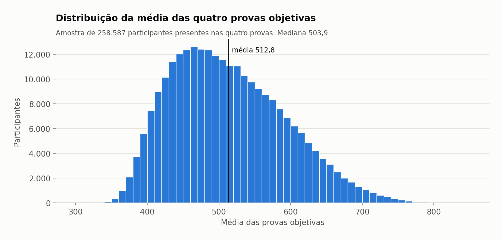

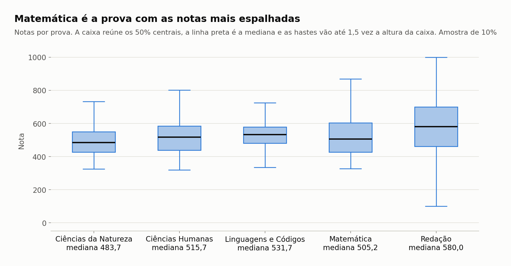

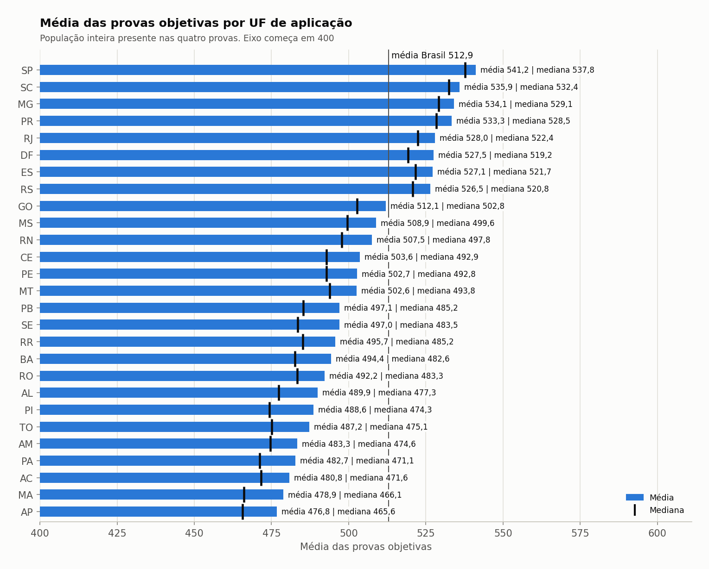

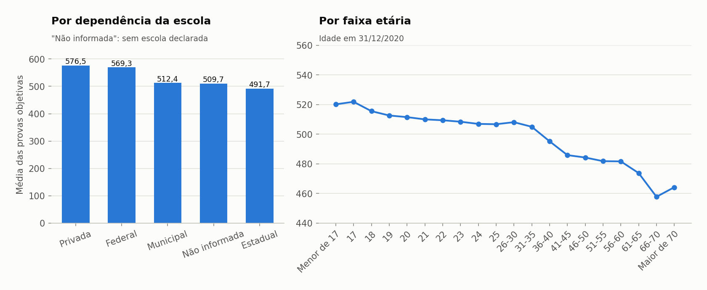

### 2. Correlações com a nota

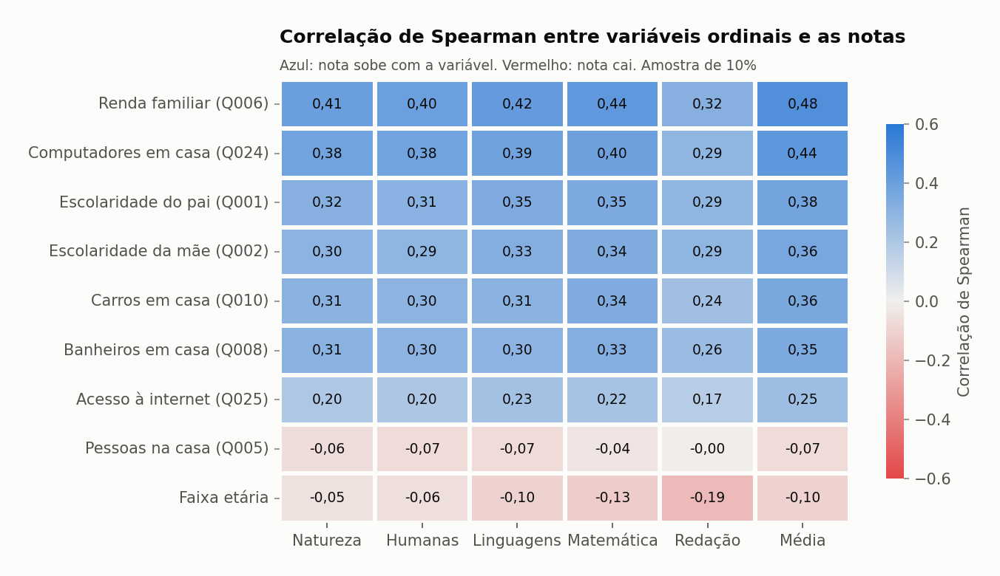

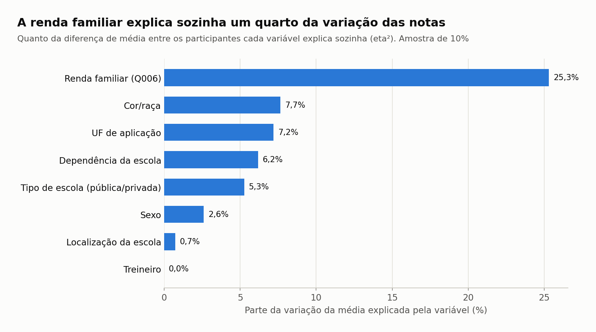

### 3. Dados da redação

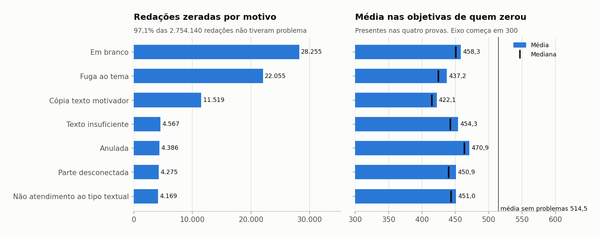

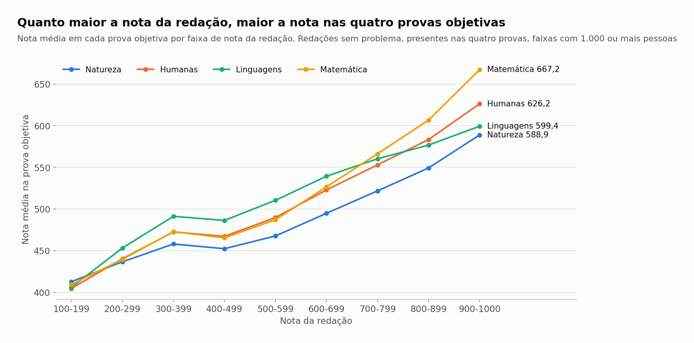

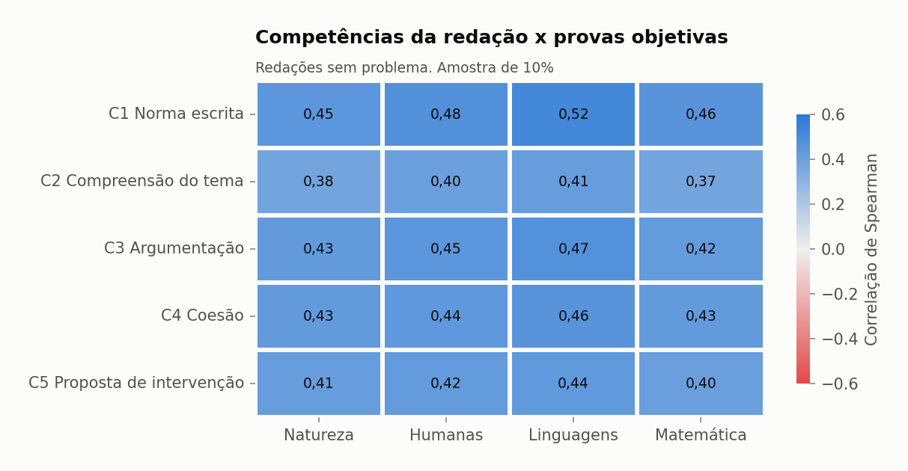

### 4. Questionário socioeconômico

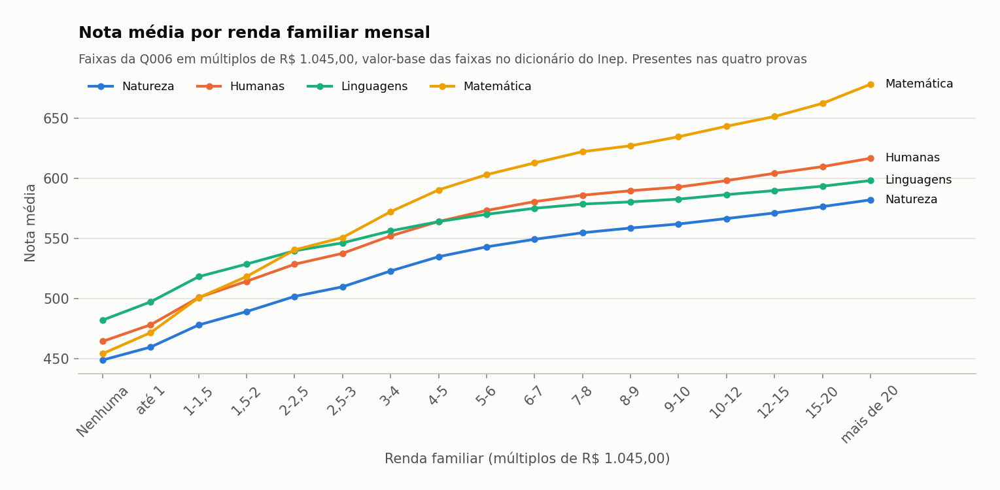

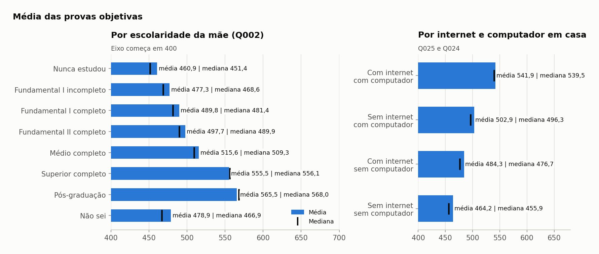

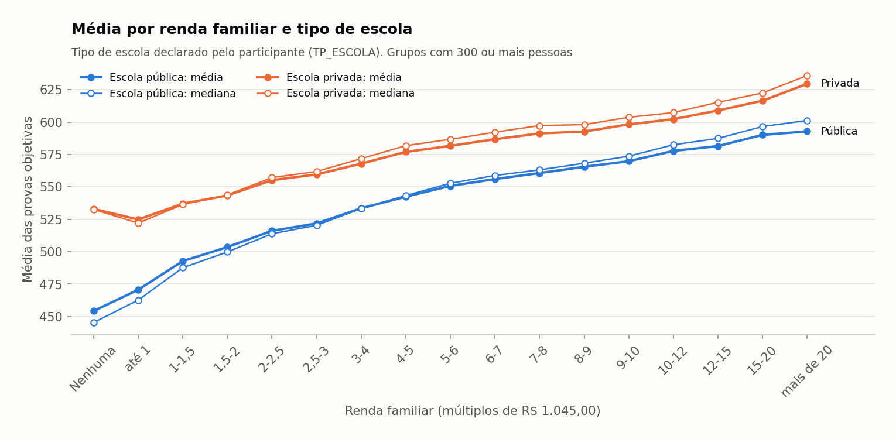

## Conclusões e insights

As relações abaixo são associações observadas nos dados. Nenhuma delas, sozinha, demonstra causa.

1. **Mais da metade dos inscritos faltou.** 55,21% não compareceram a pelo menos um dos dois dias, e só 2.588.681 pessoas (44,8% dos inscritos) fizeram as quatro provas objetivas. Como contexto, o Leia-me do Inep registra que, por causa da pandemia, as provas foram adiadas para janeiro de 2021.
2. **A renda familiar é a variável mais associada à nota.** Ela tem correlação de Spearman de 0,48 com a média e explica 25,3% da variância (eta²), mais de três vezes o valor da segunda colocada, cor/raça (7,7%).
3. **A distância entre as faixas de renda é grande.** A média vai de 462,6 entre quem declara não ter renda a 619,0 acima de R$ 20.900. Ao mesmo tempo, 52,2% dos presentes declaram renda familiar de até R$ 1.567,50.
4. **Matemática é a prova mais sensível ao contexto socioeconômico.** Entre as faixas de renda extremas, a nota de Matemática sobe 224 pontos (de 454,4 para 678,4). É também a objetiva com a maior dispersão: desvio-padrão de 117,2, contra 73,0 a 95,0 nas outras três.
5. **A rede federal se aproxima da privada.** Pela dependência administrativa da escola (dado disponível para 15,6% dos inscritos), a média é 576,5 na privada, 569,3 na federal, 512,4 na municipal e 491,7 na estadual. Nove dos dez grupos de escola com maior média são federais.
6. **A vantagem da escola privada diminui com a renda.** Pelo tipo de escola que o próprio participante declara (`TP_ESCOLA`), entre quem não tem renda a média de quem estudou em escola privada fica 78,7 pontos acima da de quem estudou em escola pública. Acima de R$ 20.900, a diferença cai para 36,6 pontos.
7. **O ambiente em casa acompanha a nota.** A média vai de 460,9 entre filhos de mães que nunca estudaram a 565,5 quando a mãe tem pós-graduação. Quem tem internet e computador em casa tem média 541,9, contra 464,2 de quem não tem nenhum dos dois.
8. **Há desigualdade por cor/raça e por sexo.** A média de participantes brancos (539,92) fica 72,8 pontos acima da de indígenas (467,16) e 49,3 acima da de pretos (490,58). As mulheres são 60,4% de quem fez as quatro provas, mas têm média 26 pontos menor que a dos homens (502,61 contra 528,58).
9. **O desempenho tem recorte regional.** Só as sete UFs do Sul e do Sudeste e o Distrito Federal ficam acima da média nacional de 512,9. Entre a maior média (SP, 541,2) e a menor (AP, 476,8) há 64,4 pontos.
10. **Redação e provas objetivas andam juntas.** 97,1% das redações corrigidas não tiveram problema. Quem zerou a redação também tem média menor nas objetivas (de 422,1 a 470,9, contra 514,5 de quem não zerou), e as cinco competências têm correlação de 0,37 a 0,52 com as quatro provas.

## Decisões e organização

As decisões de desenho estão registradas como ADRs em [`docs/adr/`](docs/adr/), com o resumo em [`docs/decisoes.md`](docs/decisoes.md). O trabalho foi organizado em [issues](https://github.com/RCHRDYv/Teste-Analista-de-Dados-SX/issues?q=is%3Aissue) no milestone "Entrega teste SX".

```
.devcontainer/      Configuração do GitHub Codespaces
docker/             Dockerfile da aplicação e certificado intermediário do Inep
sql/                DDL do esquema estrela e consultas dos indicadores
src/etl/            Extração, transformação, carga e domínios do dicionário
src/spark/          Recálculo dos indicadores em PySpark
src/qa/             QA da carga
src/analise/        Execução das consultas e geração de docs/indicadores.md
notebooks/          Notebook de visões
docs/               Modelo, ADRs, indicadores, QA, gráficos e enunciado
```

Fonte dos dados: INSTITUTO NACIONAL DE ESTUDOS E PESQUISAS EDUCACIONAIS ANÍSIO TEIXEIRA. Microdados do Enem 2020. Brasília: Inep, 2020. Disponível em: <https://www.gov.br/inep/pt-br/acesso-a-informacao/dados-abertos/microdados/enem>.
