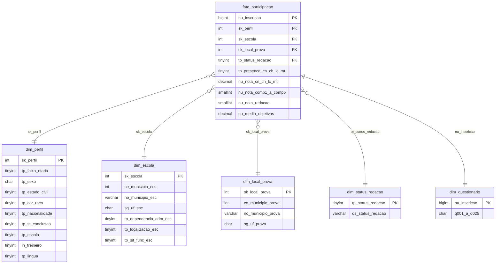

# Modelo dimensional

Esquema estrela com um fato e cinco dimensões (ADR-0002). O DDL está em [`sql/01_schema.sql`](../sql/01_schema.sql).

**Grão do fato:** uma linha por inscrição no ENEM 2020.

## Tabelas

| Tabela | Tipo | Chave | Conteúdo |
|---|---|---|---|
| `fato_participacao` | Fato | `nu_inscricao` | Presença nas quatro provas objetivas, notas, competências e nota da redação, média das objetivas e as chaves das dimensões |
| `dim_perfil` | Dimensão junk | `sk_perfil` | Combinações de faixa etária, sexo, estado civil, cor/raça, nacionalidade, situação de conclusão, tipo de escola, treineiro e língua estrangeira, com código e descrição |
| `dim_escola` | Dimensão | `sk_escola` | Município, UF, dependência administrativa, localização e situação de funcionamento da escola declarada. A linha 0 é "não informada" |
| `dim_local_prova` | Dimensão | `sk_local_prova` | Município e UF de aplicação da prova |
| `dim_status_redacao` | Dimensão | `tp_status_redacao` | Situação da redação. O código 0 ("sem redação") não existe no dicionário e cobre quem não teve redação corrigida |
| `dim_questionario` | Mini-dimensão 1:1 | `nu_inscricao` | Respostas Q001 a Q025 do questionário socioeconômico, com os códigos do dicionário |

Regras de transformação:

- Os atributos de perfil sem valor no arquivo recebem o código -1 (ou `N` no sexo), descrito como "Não informado".
- Quem não informou o município da escola aponta para `sk_escola = 0`.
- `nu_media_objetivas` é a média das quatro provas objetivas, só para quem teve presença igual a 1 nas quatro (ADR-0006).
- `nu_inscricao` é a máscara sequencial do Inep e não identifica o participante.

## Base de origem

| Item | Valor | Fonte |
|---|---|---|
| Arquivo | `DADOS/MICRODADOS_ENEM_2020.csv`, dentro de `microdados_enem_2020.zip` (620.776.982 bytes) | Portal de microdados do Inep |
| Formato | CSV separado por `;`, encoding latin-1, com cabeçalho | Leia-me, seção 3 |
| Linhas de dados | 5.783.109 (uma por inscrição) | Contagem no arquivo: 5.783.110 linhas menos o cabeçalho |
| Colunas | 76 | Cabeçalho do arquivo, igual ao dicionário |
| Inscritos com escola informada | 904.569 (15,6%) | `CO_MUNICIPIO_ESC` preenchido |
| Presentes nas quatro provas objetivas | 2.588.681 | `TP_PRESENCA_*` igual a 1 nas quatro |
| Faltaram ao dia 1 (LC, CH e redação) | 3.024.590 | `TP_PRESENCA_LC` igual a 0 |
| Faltaram ao dia 2 (CN e MT) | 3.184.243 | `TP_PRESENCA_MT` igual a 0 |

O modelo simplificado de 2020 excluiu `CO_ESCOLA`, trocou `NU_IDADE` por `TP_FAIXA_ETARIA` e retirou os municípios de nascimento e residência (Leia-me, seção 3). As colunas `TX_RESPOSTAS_*` e `TX_GABARITO_*` (vetores de respostas e gabaritos) e `CO_PROVA_*` (cor do caderno) não entram no modelo, porque nenhuma pergunta do teste depende delas.
